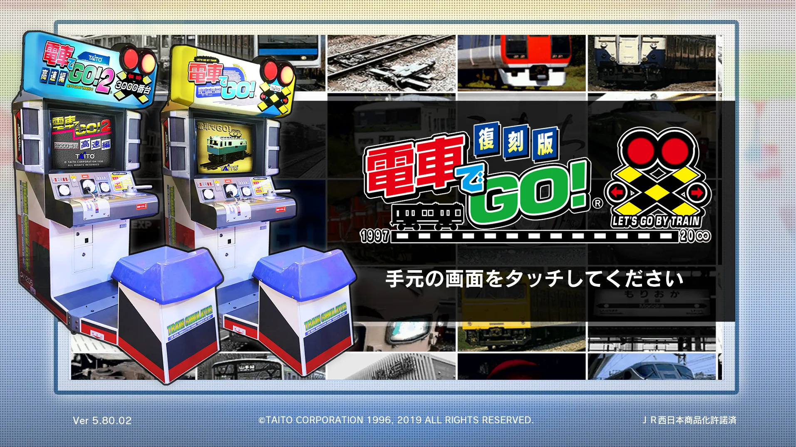

# DGO Reprint Route Audio Fix

If you run the arcade Densha de GO!! 復刻版 (the `DGOREPR` reprint of DGO1 and DGO2) without TeknoParrot, you've probably noticed the launcher has sound but the routes are completely silent. This fixes that.

The game reads the cabinet's volume knob through the USB I/O board, via `ArrowheadUSBIO.dll`. With no board plugged in, that DLL still reports success and the knob reads as 0, so the old routes play at zero volume. The launcher has its own volume setting, which is why it isn't affected, and TeknoParrot's board emulation sends a real value, which is why the routes work there. Specifically, the knob is the 16-bit value at offset `0x12` of the struct `ArrowheadUSBIOUpdate` fills in, and the game uses it as `value / 65535`, treating anything under 0.01 as muted.

The fix is a small stand-in `ArrowheadUSBIO.dll`. It loads the game's original DLL (renamed to `ArrowheadUSBIO_orig.dll`), passes every call through untouched, and just sets the volume knob after each update. Controls and everything else work exactly as before, and TeknoParrot still works with it installed. No game files are included; the installer uses the copy you already have.

It can also mute the virtual arcade's background noise that plays under the routes, if that gets on your nerves like it did mine. The other machines you hear are recorded into the audio tracks of the arcade videos (`AC1_Left*.usm` and `AC1_Right*.usm`), and the game never sets their volume, so changing `VolumeInGameMovie` does nothing. On top of that, the room ambience is a looping cue, `DGOA_BACKG` (ID `D3` in `legend.acb`). With the option on, the DLL forces the video audio volume to 0 and skips that cue, leaving just the train game's own sounds. It's off by default, and none of this patches anything unless you turn it on. It only touches memory if the game code matches 5.80.02 exactly.

I've only tested it on version 5.80.02 (64-bit Windows). If you try another version, let me know in an issue whether it worked. Some antivirus programs get suspicious of DLLs like this, so the source is in `src/` (a few hundred lines of C) if you want to check it or build it yourself with `build.bat` and [llvm-mingw](https://github.com/mstorsjo/llvm-mingw). The build is reproducible, so you should get the same file as the release.

MIT licensed, see `LICENSE`.

## Install

Copy everything from the zip into your `DGOREPR` folder (the one with `DgoRepr.exe`) and run `install.bat`. It renames `TG4AC\Binaries\Win64\dll\ArrowheadUSBIO.dll` to `ArrowheadUSBIO_orig.dll` and puts the fix and `ArrowheadUSBIO_volume.ini` in that folder. You can also do that by hand.

To change the volume, edit `Percent` (0 to 100) in `TG4AC\Binaries\Win64\dll\ArrowheadUSBIO_volume.ini`. It's read when the game starts, and running `install.bat` again won't overwrite it.

To mute the arcade background noise, set `MuteAmbience=1` under `[Arcade]` in the same file.

To uninstall, close the game and run `uninstall.bat`, or delete `ArrowheadUSBIO.dll` and `ArrowheadUSBIO_volume.ini` from that folder and rename `ArrowheadUSBIO_orig.dll` back to `ArrowheadUSBIO.dll`.

---

This fix was made with help from Claude (Anthropic's Claude Opus 5.5 model), which tracked the problem down through the game's files and wrote the DLL. I wouldn't have been able to do it without it.
